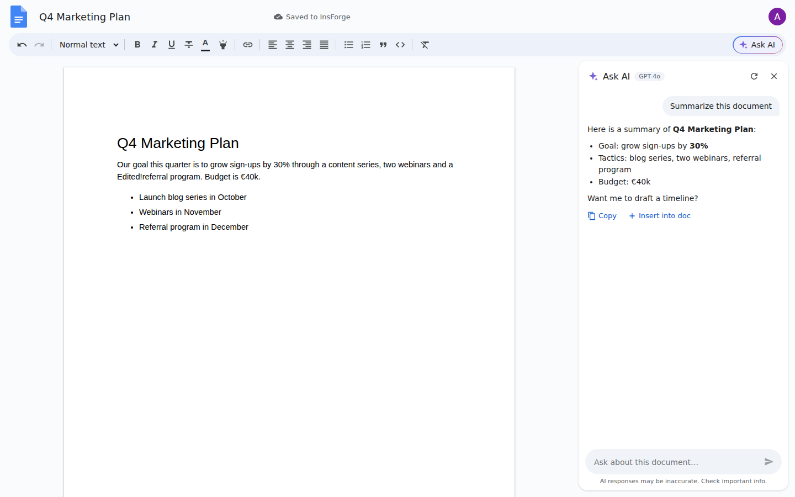

# Docs AI — Google Docs–style editor with “Ask AI”

A Google Docs–like editor with an **Ask AI** button in the formatting toolbar. It opens a side panel where you can chat with **GPT-4o** about the current document.

- **Backend:** [InsForge](https://insforge.dev) (Postgres + RLS, auth, model gateway) via `@insforge/sdk`
- **Auth:** Google OAuth through InsForge
- **LLM:** `openai/gpt-4o` through the InsForge model gateway, with streaming
- **Frontend:** React 19, Vite, TypeScript, Tiptap 3



## Features

| Area | What you get |
| --- | --- |
| Sign-in | “Sign in with Google” (InsForge OAuth). The SDK finishes the redirect on its own. |
| Home | Search, a blank-document tile and a grid of recent docs with previews. Deletes ask for confirmation. |
| Editor | A letter-size page on a canvas and an editable title. Changes autosave to InsForge, with a “Saved to InsForge” status. |
| Toolbar | Undo/redo, styles (Normal/H1–H3), bold, italic, underline, strike, text color, highlight, link, four alignments, bullet and numbered lists, quote, code, clear formatting |
| **Ask AI** | A button on the right of the toolbar (or <kbd>Ctrl/⌘+Alt+A</kbd>) opens a chat panel. The full document text goes to GPT-4o as context. If you select text, the question is scoped to that selection. Answers stream in as Markdown and can be copied or inserted into the doc. Chat history is saved per document. |
| Security | Row-level security: each user sees only their own documents and chat history. Raw HTML and `javascript:` links in model output are escaped. |

## Setup

### 1. Create the InsForge project

1. Create a project at [insforge.dev](https://insforge.dev), or self-host it.
2. Open **Dashboard → Project settings → API** and copy the **Base URL** and the **anon key**.

### 2. Create the tables

Run [`insforge/schema.sql`](insforge/schema.sql) in the dashboard SQL editor (or through the InsForge CLI/MCP). This creates `documents` and `ai_messages`, plus RLS policies scoped to `auth.uid()`.

### 3. Turn on Google OAuth

In **Authentication → Auth methods → Google**, turn on Google. You can use InsForge's shared dev credentials, or your own Google Cloud OAuth client. With your own client, add the redirect URI that InsForge shows to Google Cloud Console.

Add your app URLs (for example `http://localhost:5173` and your production URL) to the allowed redirect URLs.

### 4. Turn on GPT-4o in the model gateway

Under **AI → Models**, enable `openai/gpt-4o`. To use a different model, set `VITE_AI_MODEL`.

### 5. Run it

```bash
cp .env.example .env   # fill in VITE_INSFORGE_BASE_URL and VITE_INSFORGE_ANON_KEY
npm install
npm run dev
```

### 6. Deploy (optional)

`npm run build`, then deploy `dist/` with InsForge hosting or any static host (Vercel, Netlify…). The host must serve `index.html` for all routes (SPA fallback).

## Project layout

```
insforge/schema.sql          tables, trigger, RLS policies
src/lib/insforge.ts          SDK client + model id
src/lib/auth.tsx             Google OAuth session context
src/lib/docs.ts              document + chat-history CRUD
src/lib/ai.ts                GPT-4o streaming via the model gateway
src/components/Toolbar.tsx   formatting toolbar + “Ask AI” button
src/components/AskAIPanel.tsx chat side panel
src/pages/                   Login, Home (doc list), EditorPage
```
