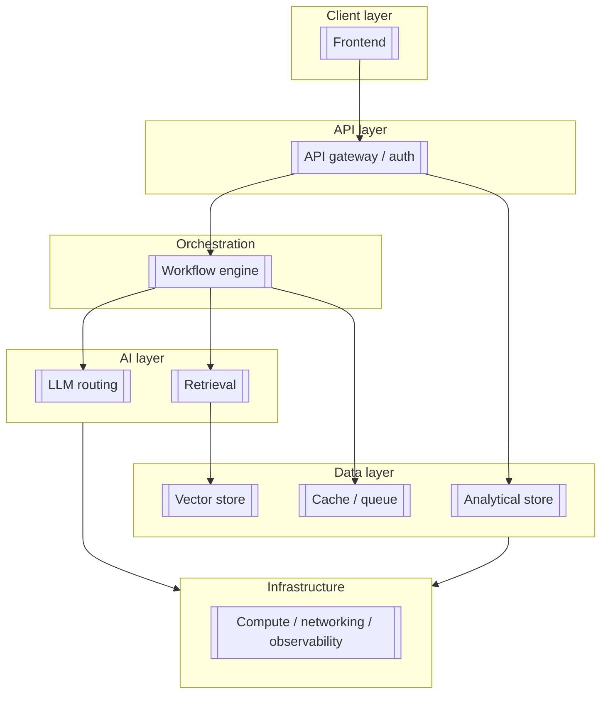

# An AI Governance Framework: Controls, Risk and Human Oversight

> **Master document.** Single source of truth for this case. The recruiter one-pager,
> the hiring-manager brief and the technical deep dive are all derived from this file.
> Change a number here first, then propagate.

| | |
|---|---|
| **Role** | [[Architect / Lead / Sole engineer — be exact]] |
| **Period** | [[2023–2025]] |
| **Team size** | [[solo / 3 engineers / cross-functional team of 8]] |
| **Status** | [[in production / decommissioned / pilot]] |
| **Demonstrates** | controls, risk management, compliance |
| **Target roles** | AI Governance Consultant |
| **Evidence level** | [[measured / estimated / anonymized]] |

---

## 1. Business problem

*What problem, for whom, and why it mattered commercially.*

- **Who had the problem:** [[org type, size, industry — anonymized if under NDA]]
- **The problem:** [[2–4 sentences, stated as the business felt it, not as a tech spec]]
- **Cost of not solving it:** [[time lost, revenue at risk, manual headcount, regulatory exposure]]
- **Why existing solutions did not fit:** [[off-the-shelf tools evaluated and rejected, with reasons]]

> Interview trap: if you cannot name who was hurting and how much it cost them, this
> reads as a hobby project. Fill this section first.

## 2. Constraints

*The real boundaries the design had to respect. Constraints are what make an
architecture defensible — without them every decision looks arbitrary.*

| Constraint | Value | Consequence for the design |
|---|---|---|
| Data volume | [[rows/events per day, total TB]] | [[why this ruled out X]] |
| Query latency budget | [[p50 / p95 targets]] | [[...]] |
| Cost ceiling | [[€/month infra, €/1k inferences]] | [[...]] |
| Security / regulatory | [[GDPR, data residency, sector rules]] | [[...]] |
| Multi-tenancy | [[tenants, isolation level required]] | [[...]] |
| Availability | [[target, maintenance windows]] | [[...]] |
| Team / time | [[people, calendar time]] | [[...]] |
| Existing estate | [[systems that could not be replaced]] | [[...]] |

## 3. Architecture

*Replace the placeholder nodes with the real components and real names. Then walk
the diagram in prose:*

- **Request path:** [[trace one real request end to end]]
- **Ingestion path:** [[trace one record from source to queryable]]
- **Failure behaviour:** [[what degrades, what fails hard, what retries]]

## 4. Technology decisions

*One row per decision that a reviewer could reasonably challenge. The alternative
column is what makes this section credible.*

| Decision | Chosen | Alternatives considered | Why chosen | What it cost |
|---|---|---|---|---|
| Analytical store | [[ClickHouse]] | [[Postgres, DuckDB, BigQuery]] | [[columnar scan profile, ingest rate at our volume]] | [[no joins at X scale, ops burden]] |
| Vector store | [[Qdrant]] | [[pgvector, Weaviate, Milvus]] | [[...]] | [[...]] |
| Orchestration | [[n8n]] | [[Airflow, Temporal, custom]] | [[...]] | [[...]] |
| LLM strategy | [[local + cloud routing]] | [[cloud-only, local-only]] | [[cost, latency, data residency]] | [[...]] |
| Cache / queue | [[Redis]] | [[...]] | [[...]] | [[...]] |
| Deployment | [[...]] | [[...]] | [[...]] | [[...]] |

**Decisions reversed:** [[what you tried and backed out of, and what it taught you —
this is the single most persuasive paragraph in the whole document]]

## 5. Implementation

*What actually exists and runs. Concrete, countable.*

- **Services / components built:** [[list with one line each]]
- **Scale of the codebase:** [[services, approximate LOC, languages]]
- **Integrations:** [[external systems connected]]
- **Delivery timeline:** [[milestone → date]]
- **What is automated vs manual:** [[be honest — reviewers respect the distinction]]

## 6. AI layer

- **Retrieval (RAG):** [[chunking strategy, embedding model, index type, re-ranking, eval]]
- **Agents:** [[what they decide autonomously, what they escalate, tool inventory]]
- **Tooling / MCP:** [[tools exposed, permission model]]
- **Orchestration:** [[how multi-step work is planned, retried, bounded]]
- **LLM routing:** [[which model for which task, and the cost/quality rule behind it]]
- **Evaluation:** [[how you know the AI layer works — test sets, offline eval, human review rate]]
- **Failure handling:** [[hallucination controls, fallbacks, timeouts, budget caps]]

> Reviewers discount any AI section with no evaluation story. If there is no eval,
> say so and say what you would build — that is still stronger than silence.

## 7. Data layer

- **Ingestion:** [[sources, mechanism, frequency, volume]]
- **Cleaning / validation:** [[rules, quarantine of bad records]]
- **Enrichment:** [[what is derived and how]]
- **Storage model:** [[schemas, partitioning, retention, tiering]]
- **Querying:** [[access patterns, materialized views, API surface]]
- **Lineage:** [[how a number in the UI is traced back to its source]]

## 8. Security & governance

- **Access control:** [[authn, authz model, tenant isolation enforcement point]]
- **Data protection:** [[encryption at rest/in transit, PII handling, minimization]]
- **GDPR posture:** [[lawful basis, retention, deletion/erasure path, DPA position]]
- **Audit & logging:** [[what is logged, retention, who can read it]]
- **AI-specific governance:** [[prompt/response logging, human-in-the-loop points,
  model change control, EU AI Act risk classification if applicable]]
- **Secrets & supply chain:** [[secret storage, dependency policy]]

## 9. Performance & economics

| Metric | Value | How measured | When |
|---|---|---|---|
| Ingest throughput | [[...]] | [[...]] | [[date]] |
| Query p50 / p95 | [[...]] | [[...]] | [[date]] |
| End-to-end AI response time | [[...]] | [[...]] | [[date]] |
| Cost per 1k inferences | [[...]] | [[...]] | [[date]] |
| Monthly infrastructure cost | [[...]] | [[...]] | [[date]] |
| Storage footprint | [[...]] | [[...]] | [[date]] |

- **Scaling headroom:** [[what breaks first at 10x and what you would do]]
- **Cost drivers:** [[the top 2–3 line items and how they were reduced]]

## 10. Outcome

- **What the system can do now:** [[capabilities, stated plainly]]
- **Value produced:** [[time saved, cost avoided, revenue enabled, risk reduced —
  with the measurement method]]
- **Who uses it and how often:** [[...]]
- **What is still open:** [[known limitations and the roadmap]]

---

## Appendix A — Anonymization notes

[[What was renamed or removed for this public version, and why.]]

## Appendix B — Artifacts available on request

[[Architecture diagrams, schema definitions, eval reports, cost dashboards, repo access.]]

## Appendix C — Interview questions this case answers

*Write the 8–10 hard questions a panel would ask about this system, and where in the
document the answer lives. This turns the case into interview preparation.*

1. [[Why not just use Postgres for all of it?]] → §4
2. [[How do you stop the agent from taking a destructive action?]] → §6, §8
3. [[...]]

---

## Focus note for this case

Singurul caz în care §8 e documentul, iar restul secțiunilor sunt context. Structura utilă: inventar de sisteme AI → clasificare de risc → controale per risc → puncte de oversight uman → evidență de audit. Dacă e relevant EU AI Act, poziționarea pe categorii de risc trebuie să fie explicită și argumentată, nu menționată în treacăt. Atenție: guvernanța descrisă trebuie să fie cea **implementată efectiv**, nu un framework teoretic — altfel cazul devine un eseu.

**Hard questions this case must answer:**
1. Cum clasifici un sistem AI nou și cine decide? → §8.4
2. Unde intervine omul și ce poate să suprascrie? → §8.4
3. Ce dovezi ai că un control chiar funcționează? → §8.5
4. Cum controlezi schimbarea de model în producție? → §8.4
